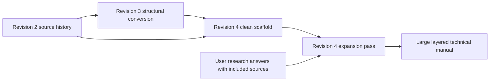

File: `REVISION4_SOURCE_CROSSWALK.md`

# Revision 4 Source Crosswalk

Last updated: 2026-05-01

## Purpose

Use this file before expanding any Revision 4 chapter. It maps the current Revision 4 manuscript files back to the Revision 3 and Revision 2 source files so a future session does not guess where the original material came from.

Revision 4 is currently a clean scaffold being expanded one chapter at a time. The expansion pass must pull source material back in from Revision 3 and Revision 2, then integrate the user's chapter-range research files.

Current manuscript files still use the first-pass 23-chapter layout. The planned final structure adds a new code lookup chapter before the glossary. When that chapter is created, update this crosswalk, the table of contents, and `AI_TODO.md`, then move the current glossary to the final glossary chapter number.

## Workspace Layout

```text
revision2/                  Source-history manuscript, useful for tone and older long-form material
revision3/                  Deprecated active manuscript, main local source for Revision 4 expansion
revision4/                  Active control folder for plans, TODOs, and research questions
revision4/manuscript/       Active Revision 4 book files
```

## Source Flow Diagram



## How To Use This Crosswalk

1. Start with the Revision 4 target file in `revision4/manuscript/`.
2. Read the listed Revision 3 primary source files first.
3. Read the listed Revision 2 source files for tone, older detail, and any material lost during structural conversion.
4. Read the listed Revision 4 research file if the topic has unresolved technical, code, legal, product, or engineering questions.
5. Expand the chapter from mapped source material and the user's research files.
6. Keep uncertain exact values soft until the research file supports them or the user confirms the direction.

## Crosswalk Table

| Revision 4 target | Main Revision 3 sources | Revision 2 source history | Revision 4 research notes | Expansion notes |
|---|---|---|---|---|
| `revision4/manuscript/BSHfm00CoverandIntro.md` | `revision3/BSHfm00CoverandIntro.md` | `revision2/BSHfm00CoverandIntro.md` | None | Preserve title and tone. Do not add unsupported claims. |
| `revision4/manuscript/BSHfm01TableofContents.md` | `revision3/BSHfm01TableofContents.md`, current Revision 4 structure | `revision2/BSHfm01tableofcontext.md` | None | Regenerate after large chapter expansion if headings change. |
| `revision4/manuscript/BSHch01PurposePrinciplesAndHowToUseThisBook.md` | `revision3/BSHch01PurposeandPrinciples.md` | `revision2/BSHsec00PurposeandPhilosophy.md` | `revision4/research_questions_ch01_ch04.md` only if legal or source-policy claims are added | Expand the quad-layer reading model and the long-life concrete-home purpose without making code claims. |
| `revision4/manuscript/BSHch02OregonCodeAndComplianceMap.md` | New Revision 4 synthesis chapter. No direct Revision 3 chapter source. Context only: `revision3/BSHch03LegalPermitsandInspections.md` for permit, inspection, owner-builder, and compliance-flow ideas. | No direct Revision 2 source. Context only: `revision2/BSHsec02LegalandRegulatoryFramework.md` and `revision2/BSHsec03Inspections.md` for older legal/inspection framing. | `revision4/research_questions_ch01_ch04.md` for verified Oregon owner-builder, trade-scope, CO/TCO, and compliance framing | This is a narrative bridge about how Oregon code works for this project. It does not own the old legal/inspection sources; those still primarily feed Chapters 4 and 18. Do not use `revision3/BSHappACodeandStandardsReference.md` or `revision2/BSHzapp0BCodeReference.md` as the main Chapter 2 source; those belong to the standards/reference and planned code lookup chapters. |
| `revision4/manuscript/BSHch03LandSiteAndFeasibility.md` | `revision3/BSHch02LandSiteandFeasibility.md` | `revision2/BSHsec01SiteandLocationEvaluation.md` | `revision4/research_questions_ch01_ch04.md` if feasibility touches permits or legal rules | Restore rich site-selection detail. Keep final jurisdiction-specific claims soft. |
| `revision4/manuscript/BSHch04LegalPermitsOwnerBuilderRulesAndInspections.md` | `revision3/BSHch03LegalPermitsandInspections.md`, selected inspection concepts from `revision3/BSHappCInspectionChecklistsPart1.md`, `revision3/BSHappCInspectionChecklistsPart2.md` | `revision2/BSHsec02LegalandRegulatoryFramework.md`, `revision2/BSHsec03Inspections.md` | `revision4/research_questions_ch01_ch04.md` | Legal and owner-builder material must be verified before hard claims. Do not display forms. |
| `revision4/manuscript/BSHch05SoilGroundPrepDrainageAndFoundationRisk.md` | `revision3/BSHch04SoilGroundPrepandFoundationRisk.md`, `revision3/BSHappDTestingProceduresPart2Soil.md` | `revision2/BSHsec14GroundPreparationandSoilTesting.md`, `revision2/BSHzapp0ETestingProceduresPart2Soil.md` | `revision4/research_questions_ch05_ch08.md` | Restore soil and testing richness. Keep DCP and bearing correlations soft until researched. |
| `revision4/manuscript/BSHch06StructuralSystemAndConcreteDesign.md` | `revision3/BSHch05StructuralDesign.md`, relevant code material from `revision3/BSHappACodeandStandardsReference.md` | `revision2/BSHsec04StructuralDesign.md`, `revision2/BSHzapp0BCodeReference.md` | `revision4/research_questions_ch05_ch08.md` | Expand structural vocabulary, load path, concrete and masonry logic. Do not invent structural sizes or capacities. |
| `revision4/manuscript/BSHch07FoundationBasementSlabsAndConcretePlacement.md` | `revision3/BSHch04SoilGroundPrepandFoundationRisk.md`, `revision3/BSHch05StructuralDesign.md`, `revision3/BSHappDTestingProceduresPart1Concrete.md`, selected `revision3/BSHappDTestingProceduresPart2Soil.md` | `revision2/BSHsec04StructuralDesign.md`, `revision2/BSHsec14GroundPreparationandSoilTesting.md`, `revision2/BSHzapp0ETestingProceduresPart1Concrete.md`, `revision2/BSHzapp0ETestingProceduresPart2Soil.md` | `revision4/research_questions_ch05_ch08.md` | This chapter was assembled from several sources. Expand placement planning, slab stack, curing, waterproofing interface, and pre-pour checks. |
| `revision4/manuscript/BSHch08EnvelopeWaterproofingThermalPerformanceAndRadon.md` | `revision3/BSHch06EnvelopeWaterandThermalPerformance.md`, `revision3/BSHappDTestingProceduresPart3EnvelopeandAir.md`, selected code material from `revision3/BSHappACodeandStandardsReference.md` | `revision2/BSHsec05EnvelopeandThermalPerformance.md`, `revision2/BSHzapp0ETestingProceduresPart3EnvelopeandAir.md`, `revision2/BSHzapp0BCodeReference.md` | `revision4/research_questions_ch05_ch08.md` | Expand envelope layers, water control, radon, insulation strategy, testing, and concrete-specific thermal issues. |
| `revision4/manuscript/BSHch09PlumbingWaterSupplyPressureTreatmentAndHotWater.md` | `revision3/BSHch07PlumbingSystems.md`, selected MEP testing and code material | `revision2/BSHsec06Plumbing.md`, `revision2/BSHzapp0ETestingProceduresPart4MEP.md`, `revision2/BSHzapp0BCodeReference.md` | `revision4/research_questions_ch09_ch12.md` | Split from old plumbing. Restore water supply, pressure, treatment, hot-water, storage, pumps, and backflow detail. |
| `revision4/manuscript/BSHch10PlumbingDWVSewageVentingSlopeDistanceAndFixtures.md` | `revision3/BSHch07PlumbingSystems.md`, selected MEP testing and code material | `revision2/BSHsec06Plumbing.md`, `revision2/BSHzapp0ETestingProceduresPart4MEP.md`, `revision2/BSHzapp0BCodeReference.md` | `revision4/research_questions_ch09_ch12.md` | Split from old plumbing. Restore DWV, sewer, septic, slope, vents, traps, cleanouts, basement fixtures, and testing detail. |
| `revision4/manuscript/BSHch11ElectricalServicePanelsGroundingAndLoadPlanning.md` | `revision3/BSHch08ElectricalPowerandLighting.md`, selected code material | `revision2/BSHsec07Electrical.md`, `revision2/BSHzapp0BCodeReference.md` | `revision4/research_questions_ch09_ch12.md` | Split from old electrical. Expand service, load planning, panels, grounding, bonding, backup, solar, EV, and utility coordination. |
| `revision4/manuscript/BSHch12ElectricalBranchCircuitsWireSizeVoltageDropLightingLowVoltageAndFuturePower.md` | `revision3/BSHch08ElectricalPowerandLighting.md`, selected MEP testing material | `revision2/BSHsec07Electrical.md`, `revision2/BSHzapp0ETestingProceduresPart4MEP.md`, `revision2/BSHzapp0BCodeReference.md` | `revision4/research_questions_ch09_ch12.md` | Split from old electrical. Restore branch circuit, receptacle, lighting, wire schedule, voltage drop, low-voltage, and future pathway material after verification. |
| `revision4/manuscript/BSHch13HVACVentilationHumidityAndAirQuality.md` | `revision3/BSHch09HVACVentilationandAirQuality.md`, `revision3/BSHappDTestingProceduresPart4MEP.md`, selected envelope testing material | `revision2/BSHsec08HVACandAir.md`, `revision2/BSHzapp0ETestingProceduresPart4MEP.md`, `revision2/BSHzapp0ETestingProceduresPart3EnvelopeandAir.md` | `revision4/research_questions_ch13_ch16.md` | Restore HVAC system logic, ventilation, humidity, exhaust, controls, commissioning, and field coordination. |
| `revision4/manuscript/BSHch14InteriorsFinishesAccessibilityAndLivability.md` | `revision3/BSHch10InteriorsFinishesandLivability.md`, selected materials content | `revision2/BSHsec09InteriorandFinishes.md`, selected `revision2/BSHzapp0CMaterialsReferencePart1.md`, `revision2/BSHzapp0CMaterialsReferencePart2.md` | `revision4/research_questions_ch13_ch16.md` | Restore livability, wet areas, storage, accessibility, finish durability, and move-in readiness. |
| `revision4/manuscript/BSHch15SmartHomeNetworkSecurityAndLocalAutomation.md` | `revision3/BSHch11SmartHomeandNetworkSystems.md`, selected electrical and HVAC interface material | `revision2/BSHsec10SmartHomePhilosophy.md`, selected `revision2/BSHsec07Electrical.md` | `revision4/research_questions_ch13_ch16.md` | Restore local-first automation, network, cameras, access control, monitoring, backup, privacy, and commissioning material. |
| `revision4/manuscript/BSHch16MaterialsSuppliersProcurementAndSubstitution.md` | `revision3/BSHappBMaterialsReferencePart1.md`, `revision3/BSHappBMaterialsReferencePart2.md` | `revision2/BSHzapp0CMaterialsReferencePart1.md`, `revision2/BSHzapp0CMaterialsReferencePart2.md` | `revision4/research_questions_ch13_ch16.md` | This chapter was created from appendix material. Expand procurement logic without stale prices, current availability claims, or unverified brand rankings. |
| `revision4/manuscript/BSHch17BuildSequenceAndSiteCoordination.md` | `revision3/BSHch12BuildSequence.md`, selected inspection and testing concepts | `revision2/BSHsec11BuildProcessandSequence.md`, selected `revision2/BSHsec03Inspections.md` | `revision4/research_questions_ch17_ch20.md` | Restore the staged owner-builder build path, sequencing, dry-in logic, hire-out decisions, and coordination. |
| `revision4/manuscript/BSHch18InspectionAndApprovalSequence.md` | `revision3/BSHch03LegalPermitsandInspections.md`, `revision3/BSHappCInspectionChecklistsPart1.md`, `revision3/BSHappCInspectionChecklistsPart2.md` | `revision2/BSHsec03Inspections.md`, `revision2/BSHzapp0DInspectionChecklistsPart1.md`, `revision2/BSHzapp0DInspectionChecklistsPart2.md` | `revision4/research_questions_ch17_ch20.md` | Created from inspection chapter plus checklist appendices. Convert checklists into readable approval gates and readiness guidance. Do not display forms. |
| `revision4/manuscript/BSHch19TestingCommissioningAndQualityControl.md` | `revision3/BSHch13TestingCommissioningandQualityControl.md`, all `revision3/BSHappDTestingProceduresPart*.md` files | `revision2/BSHsec12TestingandDevelopmentProgram.md`, all `revision2/BSHzapp0ETestingProceduresPart*.md` files | `revision4/research_questions_ch17_ch20.md` | Created from testing chapter plus testing appendices. This is one of the largest lost-detail areas and must be expanded heavily. |
| `revision4/manuscript/BSHch20DocumentationMaintenanceAndFutureUpgrades.md` | `revision3/BSHch14DocumentationMaintenanceandFutureUpgrades.md`, selected testing and build sequence material | `revision2/BSHsec11BuildProcessandSequence.md`, `revision2/BSHsec12TestingandDevelopmentProgram.md` | `revision4/research_questions_ch17_ch20.md` | Restore project binder, as-builts, maintenance, technology replacement, future upgrade, and ownership handoff detail. No displayed forms. |
| `revision4/manuscript/BSHch21BusinessAndBrandFramework.md` | `revision3/BSHch15BusinessandBrandFramework.md`, verified Chapter 4 framing where relevant | `revision2/BSHsec13BusinessandBrandFramework.md` | `revision4/research_questions_ch21_ch24.md`, selected `revision4/research_questions_ch01_ch04.md` | Keep as a main chapter. Avoid firm legal, tax, licensing, income, or insurance claims without verification. |
| `revision4/manuscript/BSHch22StandardsAndReferenceIndex.md` | `revision3/BSHappACodeandStandardsReference.md`, current chapter Code blocks | `revision2/BSHzapp0BCodeReference.md` | `revision4/research_questions_ch21_ch24.md` | Created as an index. It should help readers find source families without duplicating Chapter 2 or the planned code lookup chapter. |
| Planned `revision4/manuscript/BSHch23CodeLookupAndComplianceCrossReference.md` | `revision3/BSHappACodeandStandardsReference.md`, all final chapter-level `Code` blocks, final research answers | `revision2/BSHzapp0BCodeReference.md` | `revision4/research_questions_ch21_ch24.md` | New planned chapter before the glossary. Its priority is code lookup by topic, system, code family, inspection trigger, and book location. Create during expansion or final structure pass. |
| Planned `revision4/manuscript/BSHch24Glossary.md` from current `revision4/manuscript/BSHch23Glossary.md` | `revision3/BSHglossary.md`, final expanded manuscript terminology | `revision2/BSHzapp0AGlossary.md` | `revision4/research_questions_ch21_ch24.md`, `revision4/REVISION4_GLOSSARY_POLICY.md` | Glossary was compressed too hard. Later expansion should audit the full source glossary, include all acronyms, apply selected Level 1 threshold plus useful Level 0 technical terms, list related code pointers after definitions, and keep this as the final manuscript file. |

## Biggest Lost-Detail Areas To Restore

These source areas explain why Revision 4 is currently too small:

| Area | Main source files | Current problem |
|---|---|---|
| Glossary | `revision3/BSHglossary.md`, `revision2/BSHzapp0AGlossary.md` | Compressed from about 25k words to about 4k. Needs a full term audit later. |
| Testing and commissioning | `revision3/BSHappDTestingProceduresPart1Concrete.md` through `Part4MEP.md`, `revision3/BSHch13TestingCommissioningandQualityControl.md` | Compressed from many detailed procedure files into one short strategy chapter. |
| Code and standards | `revision3/BSHappACodeandStandardsReference.md`, `revision2/BSHzapp0BCodeReference.md` | Keep as back-matter/reference source material. Do not confuse this with Chapter 2, which is a narrative compliance map. |
| Code lookup | `revision3/BSHappACodeandStandardsReference.md`, chapter-level `Code` blocks, final research answers | Needs a new chapter before the glossary so code topics can be found quickly without mixing the lookup function into definitions. |
| Inspection readiness | `revision3/BSHappCInspectionChecklistsPart1.md`, `revision3/BSHappCInspectionChecklistsPart2.md`, `revision3/BSHch03LegalPermitsandInspections.md` | Checklists were removed as forms, but the field knowledge must return as guidance. |
| Materials and procurement | `revision3/BSHappBMaterialsReferencePart1.md`, `revision3/BSHappBMaterialsReferencePart2.md` | Old catalog detail was reduced. Restore decision logic, compatibility, storage, substitution, and documentation. |
| Electrical, HVAC, interiors, smart home, build sequence | `revision3/BSHch08ElectricalPowerandLighting.md`, `revision3/BSHch09HVACVentilationandAirQuality.md`, `revision3/BSHch10InteriorsFinishesandLivability.md`, `revision3/BSHch11SmartHomeandNetworkSystems.md`, `revision3/BSHch12BuildSequence.md` | Rich chapters became short layered summaries. Restore depth without duplicating across chapters. |

## Expansion Rule

Do not treat the current Revision 4 word count as acceptable. The current manuscript is structurally clean but under-expanded. The next writing pass should grow the chapters by restoring source detail and building the four-layer teaching model.
