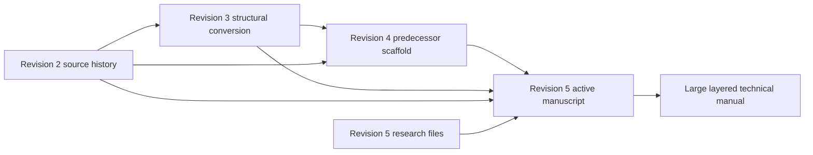

File: `SOURCE_CROSSWALK.md`

# Revision 5 Source Crosswalk

Last updated: 2026-05-08

## Purpose

Use this file before expanding any Revision 5 chapter or appendix. It maps the current Revision 5 manuscript files back through the Revision 4 predecessor files, the Revision 3 source conversion, and the Revision 2 source-history manuscript.

Revision 5 is the active working folder. It was copied forward from Revision 4, renamed, and revised. Treat Revision 5 files as authoritative for active work. Treat Revision 4 as the immediate predecessor when you need to see what was copied forward, renamed, compressed, or changed.

Current manuscript files use the Revision 5 grouped filename layout: `g0` for front matter, `g1` for chapters, and `g2` for appendices. The planned final structure adds a code lookup appendix before the glossary. When that appendix is created, update this crosswalk, the table of contents, and `AI_TODO.md`, then move the current glossary to the final appendix position.

## Workspace Layout

```text
revision2/                  Source-history manuscript, useful for tone and older long-form material
revision3/                  Structural conversion, main local source for restored detail
revision4/                  Immediate predecessor copied forward into Revision 5
revision4/manuscript/       Revision 4 predecessor manuscript files
revision5/                  Active control folder for plans, TODOs, and research questions
revision5/manuscript/       Active Revision 5 book files
```

## Source Flow Diagram



## How To Use This Crosswalk

1. Start with the Revision 5 target file in `revision5/manuscript/`.
2. Read the listed Revision 4 predecessor file when you need the immediate pre-Revision 5 chapter, older filename, or copied-forward wording.
3. Read the listed Revision 3 primary source files for restored technical detail.
4. Read the listed Revision 2 source files for tone, older detail, and material lost during structural conversion.
5. Read the listed Revision 5 research file if the topic has unresolved technical, code, legal, product, or engineering questions.
6. Expand the chapter from mapped source material and the user's research files.
7. If Revision 4 and Revision 5 differ, use the current Revision 5 file as the active manuscript unless the user asks to restore older material.
8. Keep uncertain exact values soft until the research file supports them or the user confirms the direction.

## Crosswalk Table

| Revision 5 target | Revision 4 predecessor | Main Revision 3 sources | Revision 2 source history | Revision 5 research notes | Expansion notes |
|---|---|---|---|---|---|
| `revision5/manuscript/g0_fm_00_cover-and-intro.md` | `revision4/manuscript/BSHfm00CoverandIntro.md` | `revision3/BSHfm00CoverandIntro.md` | `revision2/BSHfm00CoverandIntro.md` | None | Preserve title and tone. Do not add unsupported claims. |
| `revision5/manuscript/g0_fm_01_table-of-contents.md` | `revision4/manuscript/BSHfm01TableofContents.md` | `revision3/BSHfm01TableofContents.md`, current Revision 5 structure | `revision2/BSHfm01tableofcontext.md` | None | Regenerate after large chapter expansion if headings change. |
| `revision5/manuscript/g1_ch_01_purpose-principles-and-how-to-use-this-book.md` | `revision4/manuscript/BSHch01PurposePrinciplesAndHowToUseThisBook.md` | `revision3/BSHch01PurposeandPrinciples.md` | `revision2/BSHsec00PurposeandPhilosophy.md` | `revision5/research_questions_ch01_ch04.md` only if legal or source-policy claims are added | Expand the quad-layer reading model and the long-life concrete-home purpose without making code claims. |
| `revision5/manuscript/g1_ch_02_oregon-code-and-compliance-map.md` | `revision4/manuscript/BSHch02OregonCodeAndComplianceMap.md` | No direct Revision 3 chapter source. Context only: `revision3/BSHch03LegalPermitsandInspections.md` for permit, inspection, owner-builder, and compliance-flow ideas. | No direct Revision 2 source. Context only: `revision2/BSHsec02LegalandRegulatoryFramework.md` and `revision2/BSHsec03Inspections.md` for older legal/inspection framing. | `revision5/research_questions_ch01_ch04.md` for verified Oregon owner-builder, trade-scope, CO/TCO, and compliance framing | This is a narrative bridge about how Oregon code works for this project. It does not own the old legal/inspection sources; those still primarily feed Chapters 4 and 18. Do not use `revision3/BSHappACodeandStandardsReference.md` or `revision2/BSHzapp0BCodeReference.md` as the main Chapter 2 source; those belong to the standards/reference and planned code lookup appendices. |
| `revision5/manuscript/g1_ch_03_land-site-and-feasibility.md` | `revision4/manuscript/BSHch03LandSiteAndFeasibility.md` | `revision3/BSHch02LandSiteandFeasibility.md` | `revision2/BSHsec01SiteandLocationEvaluation.md` | `revision5/research_questions_ch01_ch04.md` if feasibility touches permits or legal rules | Restore rich site-selection detail. Keep final jurisdiction-specific claims soft. |
| `revision5/manuscript/g1_ch_04_legal-permits-owner-builder-rules-and-inspections.md` | `revision4/manuscript/BSHch04LegalPermitsOwnerBuilderRulesAndInspections.md` | `revision3/BSHch03LegalPermitsandInspections.md`, selected inspection concepts from `revision3/BSHappCInspectionChecklistsPart1.md`, `revision3/BSHappCInspectionChecklistsPart2.md` | `revision2/BSHsec02LegalandRegulatoryFramework.md`, `revision2/BSHsec03Inspections.md` | `revision5/research_questions_ch01_ch04.md` | Legal and owner-builder material must be verified before hard claims. Do not display forms. |
| `revision5/manuscript/g1_ch_05_soil-ground-prep-drainage-and-foundation-risk.md` | `revision4/manuscript/BSHch05SoilGroundPrepDrainageAndFoundationRisk.md` | `revision3/BSHch04SoilGroundPrepandFoundationRisk.md`, `revision3/BSHappDTestingProceduresPart2Soil.md` | `revision2/BSHsec14GroundPreparationandSoilTesting.md`, `revision2/BSHzapp0ETestingProceduresPart2Soil.md` | `revision5/research_questions_ch05_ch08.md` | Restore soil and testing richness. Keep DCP and bearing correlations soft until researched. |
| `revision5/manuscript/g1_ch_06_structural-system-and-concrete-design.md` | `revision4/manuscript/BSHch06StructuralSystemAndConcreteDesign.md` | `revision3/BSHch05StructuralDesign.md`, relevant code material from `revision3/BSHappACodeandStandardsReference.md` | `revision2/BSHsec04StructuralDesign.md`, `revision2/BSHzapp0BCodeReference.md` | `revision5/research_questions_ch05_ch08.md` | Expand structural vocabulary, load path, concrete and masonry logic. Do not invent structural sizes or capacities. |
| `revision5/manuscript/g1_ch_07_foundation-basement-slabs-and-concrete-placement.md` | `revision4/manuscript/BSHch07FoundationBasementSlabsAndConcretePlacement.md` | `revision3/BSHch04SoilGroundPrepandFoundationRisk.md`, `revision3/BSHch05StructuralDesign.md`, `revision3/BSHappDTestingProceduresPart1Concrete.md`, selected `revision3/BSHappDTestingProceduresPart2Soil.md` | `revision2/BSHsec04StructuralDesign.md`, `revision2/BSHsec14GroundPreparationandSoilTesting.md`, `revision2/BSHzapp0ETestingProceduresPart1Concrete.md`, `revision2/BSHzapp0ETestingProceduresPart2Soil.md` | `revision5/research_questions_ch05_ch08.md`, `revision5/research_questions_phase2_owner_fabrication_and_equipment.md` for owner-builder concrete mixing | This chapter was assembled from several sources. Expand placement planning, slab stack, curing, waterproofing interface, make-versus-buy concrete decisions, and pre-pour checks. |
| `revision5/manuscript/g1_ch_08_envelope-waterproofing-thermal-performance-and-radon.md` | `revision4/manuscript/BSHch08EnvelopeWaterproofingThermalPerformanceAndRadon.md` | `revision3/BSHch06EnvelopeWaterandThermalPerformance.md`, `revision3/BSHappDTestingProceduresPart3EnvelopeandAir.md`, selected code material from `revision3/BSHappACodeandStandardsReference.md` | `revision2/BSHsec05EnvelopeandThermalPerformance.md`, `revision2/BSHzapp0ETestingProceduresPart3EnvelopeandAir.md`, `revision2/BSHzapp0BCodeReference.md` | `revision5/research_questions_ch05_ch08.md` | Expand envelope layers, water control, radon, insulation strategy, testing, and concrete-specific thermal issues. |
| `revision5/manuscript/g1_ch_09_plumbing-water-supply-pressure-treatment-and-hot-water.md` | `revision4/manuscript/BSHch09PlumbingWaterSupplyPressureTreatmentAndHotWater.md` | `revision3/BSHch07PlumbingSystems.md`, selected MEP testing and code material | `revision2/BSHsec06Plumbing.md`, `revision2/BSHzapp0ETestingProceduresPart4MEP.md`, `revision2/BSHzapp0BCodeReference.md` | `revision5/research_questions_ch09_ch12.md` | Split from old plumbing. Restore water supply, pressure, treatment, hot-water, storage, pumps, and backflow detail. |
| `revision5/manuscript/g1_ch_10_plumbing-dwv-sewage-venting-slope-distance-and-fixtures.md` | `revision4/manuscript/BSHch10PlumbingDWVSewageVentingSlopeDistanceAndFixtures.md` | `revision3/BSHch07PlumbingSystems.md`, selected MEP testing and code material | `revision2/BSHsec06Plumbing.md`, `revision2/BSHzapp0ETestingProceduresPart4MEP.md`, `revision2/BSHzapp0BCodeReference.md` | `revision5/research_questions_ch09_ch12.md` | Split from old plumbing. Restore DWV, sewer, septic, slope, vents, traps, cleanouts, basement fixtures, and testing detail. |
| `revision5/manuscript/g1_ch_11_electrical-service-panels-grounding-and-load-planning.md` | `revision4/manuscript/BSHch11ElectricalServicePanelsGroundingAndLoadPlanning.md` | `revision3/BSHch08ElectricalPowerandLighting.md`, selected code material | `revision2/BSHsec07Electrical.md`, `revision2/BSHzapp0BCodeReference.md` | `revision5/research_questions_ch09_ch12.md` | Split from old electrical. Expand service, load planning, panels, grounding, bonding, backup, solar, EV, and utility coordination. |
| `revision5/manuscript/g1_ch_12_electrical-branch-circuits-wire-size-voltage-drop-lighting-low-voltage-and-future-power.md` | `revision4/manuscript/BSHch12ElectricalBranchCircuitsWireSizeVoltageDropLightingLowVoltageAndFuturePower.md` | `revision3/BSHch08ElectricalPowerandLighting.md`, selected MEP testing material | `revision2/BSHsec07Electrical.md`, `revision2/BSHzapp0ETestingProceduresPart4MEP.md`, `revision2/BSHzapp0BCodeReference.md` | `revision5/research_questions_ch09_ch12.md` | Split from old electrical. Restore branch circuit, receptacle, lighting, wire schedule, voltage drop, low-voltage, and future pathway material after verification. |
| `revision5/manuscript/g1_ch_13_hvac-ventilation-humidity-and-air-quality.md` | `revision4/manuscript/BSHch13HVACVentilationHumidityAndAirQuality.md` | `revision3/BSHch09HVACVentilationandAirQuality.md`, `revision3/BSHappDTestingProceduresPart4MEP.md`, selected envelope testing material | `revision2/BSHsec08HVACandAir.md`, `revision2/BSHzapp0ETestingProceduresPart4MEP.md`, `revision2/BSHzapp0ETestingProceduresPart3EnvelopeandAir.md` | `revision5/research_questions_ch13_ch16.md` | Restore HVAC system logic, ventilation, humidity, exhaust, controls, commissioning, and field coordination. |
| `revision5/manuscript/g1_ch_14_interiors-finishes-accessibility-and-livability.md` | `revision4/manuscript/BSHch14InteriorsFinishesAccessibilityAndLivability.md` | `revision3/BSHch10InteriorsFinishesandLivability.md`, selected materials content | `revision2/BSHsec09InteriorandFinishes.md`, selected `revision2/BSHzapp0CMaterialsReferencePart1.md`, `revision2/BSHzapp0CMaterialsReferencePart2.md` | `revision5/research_questions_ch13_ch16.md` | Restore livability, wet areas, storage, accessibility, finish durability, and move-in readiness. |
| `revision5/manuscript/g1_ch_15_smart-home-network-security-and-local-automation.md` | `revision4/manuscript/BSHch15SmartHomeNetworkSecurityAndLocalAutomation.md` | `revision3/BSHch11SmartHomeandNetworkSystems.md`, selected electrical and HVAC interface material | `revision2/BSHsec10SmartHomePhilosophy.md`, selected `revision2/BSHsec07Electrical.md` | `revision5/research_questions_ch13_ch16.md` | Restore local-first automation, network, cameras, access control, monitoring, backup, privacy, and commissioning material. |
| `revision5/manuscript/g1_ch_16_materials-suppliers-procurement-and-substitution.md` | `revision4/manuscript/BSHch16MaterialsSuppliersProcurementAndSubstitution.md` | `revision3/BSHappBMaterialsReferencePart1.md`, `revision3/BSHappBMaterialsReferencePart2.md` | `revision2/BSHzapp0CMaterialsReferencePart1.md`, `revision2/BSHzapp0CMaterialsReferencePart2.md` | `revision5/research_questions_ch13_ch16.md`, `revision5/research_questions_phase2_owner_fabrication_and_equipment.md` for CMU manufacture | This chapter was created from appendix material. Expand procurement logic without stale prices, current availability claims, or unverified brand rankings. |
| `revision5/manuscript/g1_ch_17_build-sequence-and-site-coordination.md` | `revision4/manuscript/BSHch17BuildSequenceAndSiteCoordination.md` | `revision3/BSHch12BuildSequence.md`, selected inspection and testing concepts | `revision2/BSHsec11BuildProcessandSequence.md`, selected `revision2/BSHsec03Inspections.md` | `revision5/research_questions_ch17_ch20.md`, `revision5/research_questions_phase2_owner_fabrication_and_equipment.md` for heavy-equipment selection | Restore the staged owner-builder build path, sequencing, dry-in logic, hire-out decisions, equipment decisions, and coordination. |
| `revision5/manuscript/g1_ch_18_inspection-and-approval-sequence.md` | `revision4/manuscript/BSHch18InspectionAndApprovalSequence.md` | `revision3/BSHch03LegalPermitsandInspections.md`, `revision3/BSHappCInspectionChecklistsPart1.md`, `revision3/BSHappCInspectionChecklistsPart2.md` | `revision2/BSHsec03Inspections.md`, `revision2/BSHzapp0DInspectionChecklistsPart1.md`, `revision2/BSHzapp0DInspectionChecklistsPart2.md` | `revision5/research_questions_ch17_ch20.md` | Created from inspection chapter plus checklist appendices. Convert checklists into readable approval gates and readiness guidance. Do not display forms. |
| `revision5/manuscript/g1_ch_19_testing-commissioning-and-quality-control.md` | `revision4/manuscript/BSHch19TestingCommissioningAndQualityControl.md` | `revision3/BSHch13TestingCommissioningandQualityControl.md`, all `revision3/BSHappDTestingProceduresPart*.md` files | `revision2/BSHsec12TestingandDevelopmentProgram.md`, all `revision2/BSHzapp0ETestingProceduresPart*.md` files | `revision5/research_questions_ch17_ch20.md` | Created from testing chapter plus testing appendices. This is one of the largest lost-detail areas and must be expanded heavily. |
| `revision5/manuscript/g1_ch_20_documentation-maintenance-and-future-upgrades.md` | `revision4/manuscript/BSHch20DocumentationMaintenanceAndFutureUpgrades.md` | `revision3/BSHch14DocumentationMaintenanceandFutureUpgrades.md`, selected testing and build sequence material | `revision2/BSHsec11BuildProcessandSequence.md`, `revision2/BSHsec12TestingandDevelopmentProgram.md` | `revision5/research_questions_ch17_ch20.md` | Restore project binder, as-builts, maintenance, technology replacement, future upgrade, and ownership handoff detail. No displayed forms. |
| `revision5/manuscript/g1_ch_21_business-and-brand-framework.md` | `revision4/manuscript/BSHch21BusinessAndBrandFramework.md` | `revision3/BSHch15BusinessandBrandFramework.md`, verified Chapter 4 framing where relevant | `revision2/BSHsec13BusinessandBrandFramework.md` | `revision5/research_questions_ch21_ch24.md`, selected `revision5/research_questions_ch01_ch04.md` | Keep as a main chapter. Avoid firm legal, tax, licensing, income, or insurance claims without verification. |
| `revision5/manuscript/g2_app_01_standards-and-reference-index.md` | `revision4/manuscript/BSHch22StandardsAndReferenceIndex.md` | `revision3/BSHappACodeandStandardsReference.md`, current chapter Code blocks | `revision2/BSHzapp0BCodeReference.md` | `revision5/research_questions_ch21_ch24.md` | Created as an index. It should help readers find source families without duplicating Chapter 2 or the planned code lookup appendix. |
| Planned `revision5/manuscript/g2_app_02_code-lookup-and-compliance-cross-reference.md` | No current Revision 4 file. Planned in Revision 4 as `revision4/manuscript/BSHch23CodeLookupAndComplianceCrossReference.md`. | `revision3/BSHappACodeandStandardsReference.md`, all final chapter-level `Code` blocks, final research answers | `revision2/BSHzapp0BCodeReference.md` | `revision5/research_questions_ch21_ch24.md` | New planned appendix before the glossary. Its priority is code lookup by topic, system, code family, inspection trigger, and book location. Create during expansion or final structure pass. |
| `revision5/manuscript/g2_app_02_glossary.md` (current; later move to `revision5/manuscript/g2_app_03_glossary.md`) | `revision4/manuscript/BSHch23Glossary.md` | `revision3/BSHglossary.md`, final expanded manuscript terminology | `revision2/BSHzapp0AGlossary.md` | `revision5/research_questions_ch21_ch24.md`, `revision5/GLOSSARY_POLICY.md` | Glossary was compressed too hard. Later expansion should audit the full source glossary, include all acronyms, apply selected Level 1 threshold plus useful Level 0 technical terms, list related code pointers after definitions, and keep this as the final manuscript file after the code lookup appendix is created. |

## Biggest Lost-Detail Areas To Restore

These source areas explain why earlier Revision 4 and Revision 5 drafts may be too small:

| Area | Main source files | Current problem |
|---|---|---|
| Glossary | `revision4/manuscript/BSHch23Glossary.md`, `revision3/BSHglossary.md`, `revision2/BSHzapp0AGlossary.md` | Compressed from the older source glossary. Needs a full term audit later. |
| Testing and commissioning | `revision4/manuscript/BSHch19TestingCommissioningAndQualityControl.md`, `revision3/BSHappDTestingProceduresPart1Concrete.md` through `Part4MEP.md`, `revision3/BSHch13TestingCommissioningandQualityControl.md` | Detailed procedure material was compressed into one shorter strategy chapter. |
| Code and standards | `revision4/manuscript/BSHch22StandardsAndReferenceIndex.md`, `revision3/BSHappACodeandStandardsReference.md`, `revision2/BSHzapp0BCodeReference.md` | Keep as back-matter/reference source material. Do not confuse this with Chapter 2, which is a narrative compliance map. |
| Code lookup | `revision3/BSHappACodeandStandardsReference.md`, chapter-level `Code` blocks, final research answers | Needs a new appendix before the glossary so code topics can be found quickly without mixing the lookup function into definitions. |
| Inspection readiness | `revision4/manuscript/BSHch18InspectionAndApprovalSequence.md`, `revision3/BSHappCInspectionChecklistsPart1.md`, `revision3/BSHappCInspectionChecklistsPart2.md`, `revision3/BSHch03LegalPermitsandInspections.md` | Checklists were removed as forms, but the field knowledge must return as guidance. |
| Materials and procurement | `revision4/manuscript/BSHch16MaterialsSuppliersProcurementAndSubstitution.md`, `revision3/BSHappBMaterialsReferencePart1.md`, `revision3/BSHappBMaterialsReferencePart2.md` | Old catalog detail was reduced. Restore decision logic, compatibility, storage, substitution, and documentation. |
| Electrical, HVAC, interiors, smart home, build sequence | Revision 4 predecessor chapters 11 through 17, plus `revision3/BSHch08ElectricalPowerandLighting.md`, `revision3/BSHch09HVACVentilationandAirQuality.md`, `revision3/BSHch10InteriorsFinishesandLivability.md`, `revision3/BSHch11SmartHomeandNetworkSystems.md`, `revision3/BSHch12BuildSequence.md` | Rich chapters became short layered summaries. Restore depth without duplicating across chapters. |

## Expansion Rule

Do not treat the current Revision 5 word count as acceptable. The current manuscript is structurally clean but under-expanded. The next writing pass should grow the chapters by restoring source detail and building the four-layer teaching model.
